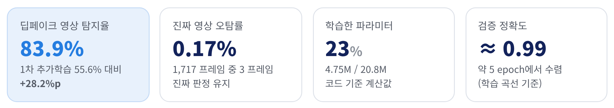
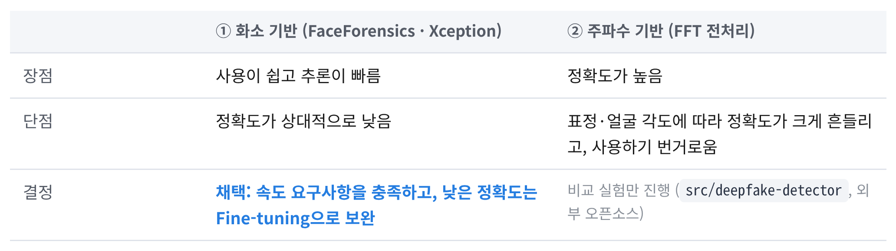
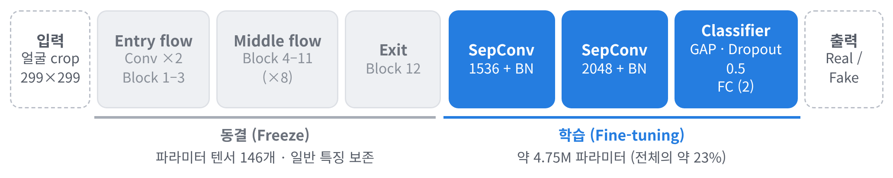
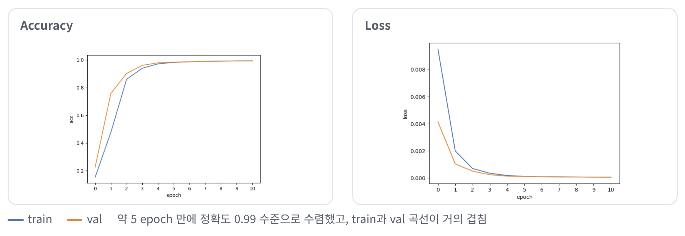
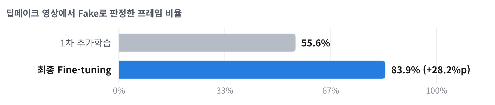
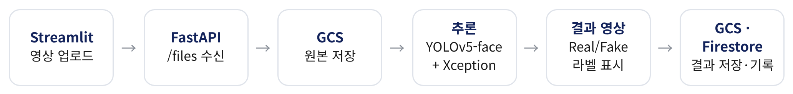

# Deepbugger · FAKE ID

**한국인 특화 딥페이크 영상 탐지 서비스**: FaceForensics++로 학습된 XceptionNet을 한국인 데이터로 Fine-tuning하고, 웹 서비스로 연결한 팀 프로젝트입니다. (인공지능사관학교)



## 문제 정의

FaceForensics++ 기학습 XceptionNet을 AI Hub 한국인 딥페이크 영상에 그대로 적용했을 때 판별 결과가 불안정했습니다. 원인은 학습 데이터의 도메인 차이(한국인 얼굴 부족)로 보고, 모델 구조는 유지한 채 **한국인 데이터로 상위층만 다시 학습**하는 방향을 택했습니다.

탐지 방식은 화소 기반(Xception)과 주파수 기반(FFT)을 비교한 뒤, 처리 속도 요구사항을 고려해 화소 기반을 선택했습니다.



## 데이터 준비

- AI Hub 딥페이크 변조 영상(한국인) 사용, 진짜·가짜 각각 train/val 8:2 분할
- 기학습 데이터와 같은 화질 분포(480p·720p 80%)에 맞춰 화질과 영상 길이를 조정
- YOLOv5-face로 얼굴 검출 → bbox 1.3배 정사각 crop → 299×299, [-1, 1] 정규화


## Fine-tuning

하위층은 일반적인 특징(엣지, 텍스처)을 학습하므로 동결하고, 위조 흔적 같은 고차원 특징을 학습하는 상위층만 다시 학습했습니다. `train.py`에서 앞 146개 파라미터 텐서(Block 12까지)를 동결하며, 학습하는 파라미터는 약 4.75M(전체의 약 23%)입니다.



| 항목 | 설정 |
|---|---|
| Base model | XceptionNet (FaceForensics++ c0 기학습 가중치) |
| 학습 범위 | Exit flow의 SeparableConv 2개 + 분류기 (Dropout 0.5, FC 2) |
| Optimizer | Adam (β = 0.9 / 0.999), lr 1e-7 |
| Scheduler | StepLR (step 5, γ 0.5) |
| Loss | CrossEntropy |
| Batch / Epoch | 512 / 최대 20 (Early stopping, patience 3) |



## 결과

1차 추가학습 모델과 최종 Fine-tuning 모델을 같은 영상으로 비교했습니다. 프레임마다 판정한 뒤 Fake로 판정된 프레임 비율을 계산했습니다.

| 테스트 영상 | 1차 추가학습 | 최종 Fine-tuning |
|---|---|---|
| 진짜 영상 (1,717 프레임) | Fake 0.12% → 진짜 ✓ | Fake 0.17% → 진짜 ✓ |
| 딥페이크 영상 (1,071 프레임) | Fake 55.6% → 판별 불가 | **Fake 83.9% → 가짜 ✓** |



딥페이크 프레임 검출률을 **+28.2%p** 높이면서, 진짜 영상의 오탐률은 0.17%로 유지했습니다.

## 서비스 구조



- **FastAPI** (`src/main.py`): 영상을 받아 GCS에 저장하고 추론한 뒤, 결과 영상과 판정을 GCS와 Firestore에 기록
- **Streamlit** (`web/web_main.py`): 영상 업로드, Fake 비율 게이지, 결과 영상 표시 (50%를 넘으면 Fake)

## 프로젝트 구조

```
├─ train.py                 # Fine-tuning 학습
├─ network/                 # Xception 구조, 분류기 교체
├─ dataset/                 # 전처리 (resize, 정규화)
├─ extract_face.py          # 영상 → 얼굴 crop 이미지
├─ face_detector.py         # YOLOv5-face 래퍼
├─ test.py                  # 이미지 단위 판정
├─ test_from_video.py       # 영상 프레임별 판정, 결과 영상 생성
├─ src/main.py              # FastAPI 서버
├─ src/google_cloud/        # GCS, Firestore 연동
├─ web/web_main.py          # Streamlit 웹
├─ models/, utils/          # yolov5-face (외부 코드)
└─ docs/images/             # README 그림
```

## 실행 참고

- 패키지: `pip install -r requirements.txt` (PyTorch 1.12, CUDA 11.6 기준)
- 모델 가중치(`models/*.pkl`)와 테스트 영상은 용량과 초상권 문제로 저장소에 포함하지 않았습니다.
- GCP·Firebase 인증 키는 저장소에 없습니다. 직접 발급한 키를 `src/google_cloud/config/`에 두고 사용해야 합니다 (`.gitignore` 처리됨).

## 한계 및 개선 방향

- 결과는 영상 2개로 사례를 검증한 수준이라, 별도 테스트셋에서 Accuracy·AUC·F1로 정량 평가가 필요합니다.
- 프레임 단위 분할은 같은 영상의 프레임이 train/val에 섞일 수 있어, 영상·인물 단위 분할로 일반화 성능을 검증해야 합니다.
- 영상 판정을 고정 임계값 대신 프레임 확률 평균이나 시간 축 스무딩으로 개선할 수 있습니다.

## 참고

- Rössler et al., *FaceForensics++: Learning to Detect Manipulated Facial Images*, ICCV 2019
- 얼굴 검출: [deepcam-cn/yolov5-face](https://github.com/deepcam-cn/yolov5-face) (GPL-3.0)
- 데이터: AI Hub 딥페이크 변조 영상
